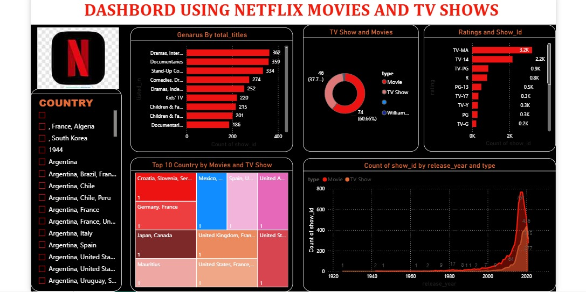

# 🎬 Netflix Data Analysis Dashboard

An interactive **Netflix Data Analysis Dashboard** developed using **Microsoft Power BI** to analyze Netflix movies and TV shows and identify meaningful trends, patterns, and insights from the dataset.

---

## 📌 Project Overview

This project focuses on analyzing Netflix's content library using **Microsoft Power BI**.

The dashboard provides an interactive view of Netflix content based on different attributes such as:

- Movies and TV Shows
- Release Year
- Content Rating
- Genre
- Country
- Duration
- Year Added
- Content Type

The main objective of this project is to transform raw Netflix data into meaningful and easy-to-understand visual insights using data cleaning, data transformation, data analysis, and interactive data visualization.

---

## 🎯 Project Objectives

- Analyze the distribution of Movies and TV Shows on Netflix
- Identify Netflix content trends over the years
- Analyze popular genres
- Understand country-wise content distribution
- Analyze content ratings
- Identify changes in Netflix's content library over time
- Build an interactive and user-friendly Power BI dashboard
- Present business insights through data visualization

---

## 🛠️ Tools & Technologies

- **Microsoft Power BI**
- **Power Query**
- **DAX**
- **Data Cleaning**
- **Data Transformation**
- **Data Analysis**
- **Data Visualization**
- **Excel / CSV Dataset**

---

## 📊 Dashboard Features

### 🎥 Content Analysis

- Total Movies
- Total TV Shows
- Total Titles
- Movies vs TV Shows distribution

### 📅 Time Analysis

- Content added by year
- Release year trends
- Netflix content growth over time

### 🎭 Genre Analysis

- Popular genres
- Genre distribution
- Content categories

### 🌍 Geographic Analysis

- Country-wise content distribution
- Major content-producing countries

### 🔞 Rating Analysis

- Content rating distribution
- Rating-wise content trends

---

## 📈 Key Insights

The dashboard helps identify:

- The distribution of Movies and TV Shows available on Netflix
- How Netflix's content library has changed over time
- Major countries contributing to Netflix's content library
- Popular genres available on the platform
- Distribution of different content ratings
- Trends in Netflix content additions
- Differences between Movies and TV Shows

---

## 🔄 Data Preparation

The dataset was prepared and transformed using **Power Query** before creating the dashboard.

The data preparation process included:

1. Removing unnecessary data
2. Handling missing values
3. Cleaning text fields
4. Transforming columns
5. Formatting data types
6. Splitting and transforming columns where required
7. Preparing the dataset for analysis
8. Creating the required calculations for visualization

---

## 📐 Data Analysis

Power BI was used to analyze the Netflix dataset and create interactive visualizations.

The dashboard uses:

- KPI Cards
- Bar Charts
- Column Charts
- Line Charts
- Donut Charts
- Maps
- Slicers
- Filters
- Interactive Visualizations
- DAX-based calculations

---

## 🖥️ Dashboard Preview

---

## 📁 Project Files

| File | Description |
|------|-------------|
| `NETFLIX_DASHBORD.pbit` | Power BI dashboard template |
| `netflix-dashboard.png.jpeg` | Netflix dashboard preview |
| `README.md` | Project documentation |

---

## 💡 Skills Demonstrated

- Data Analysis
- Exploratory Data Analysis
- Data Cleaning
- Data Transformation
- Microsoft Power BI
- Power Query
- DAX
- Data Visualization
- Dashboard Development
- Business Intelligence
- Data Storytelling

---

## 🚀 How to Use

1. Download the `NETFLIX_DASHBORD.pbit` file from this repository.
2. Open the file using **Microsoft Power BI Desktop**.
3. If required, provide the dataset/source location when prompted.
4. Refresh the data.
5. Explore the interactive dashboard using filters and slicers.

---

## 👩‍💻 Author

### Aaditi Chavare

**Final-Year B.Tech Computer Science Engineering**  
**Specialization: Artificial Intelligence & Data Science**

Interested in:

- Data Analytics
- Business Intelligence
- Artificial Intelligence
- Power BI
- Software Development

---

## 🔗 Connect With Me

- **LinkedIn:** [Aaditi Chavare](https://www.linkedin.com/in/aaditi-chavare-0118942b2/)
- **GitHub:** [aaditi86](https://github.com/aaditi86)

---

## ⭐ Project

If you find this project useful, feel free to explore the repository and connect with me on LinkedIn.

**Thank you for visiting my project!** 🚀

